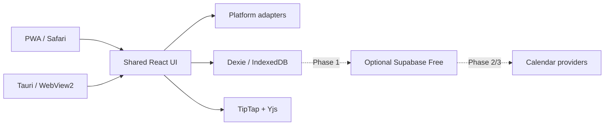

# VeloraDesk

A calm, original workspace for your days and ideas. One TypeScript UI runs as a
PWA and a Windows 11 desktop app.

**Phase 0 foundation preview.** Explore the light/dark design gallery, motion,
accessible dialogs, command palette and a persistent multilingual editor study.
Today, Calendar, Notes, Journal, Workspace and cloud auth/sync are later phases.
See [the phase report](docs/PHASE-0-REPORT.md) for download/preview evidence and gaps.

## Run and verify

Install Node 24 and pnpm 11.19.0, then:

```sh
pnpm install --frozen-lockfile
pnpm brand:build
pnpm dev
pnpm check
pnpm run licenses
pnpm exec playwright install --with-deps chromium webkit firefox
pnpm e2e
```

`/design` is the gallery; `/spikes/editor` is the study. For the full screenshot
matrix, build, start `pnpm --filter @veloradesk/web preview --port 4173`, then run
`pnpm shots`. Review the contact sheets in `docs/screenshots/` before reporting.

`pnpm build:desktop` omits the service worker. With Rust 1.99.0 and Visual Studio
C++ Build Tools on Windows, run `pnpm --filter @veloradesk/desktop build`.

## Install

On iPhone/iPad, open the preview in Safari → Share → Add to Home Screen; keep
“Open as Web App” enabled where shown. Desktop browsers use their install menu.
An online first visit is required. Subsequent cached reloads can work offline.
Physical device verification remains required.

Download the x64 Windows setup executable and verify SHA256SUMS.txt. The initial
installer is unsigned. SmartScreen may warn: “More info” → “Run anyway” after
checking source/checksum. Installation is per-user with a Start menu entry.
The updater public key is provisioned; signed update delivery is a Phase 1 task.

## Architecture



The editor study persists on this browser origin. BroadcastChannel connects
same-device tabs, not different devices. Unit tests simulate disconnected Yjs
clients; that is not a completed cloud sync engine. Keep important data backed up.

`apps/web` contains the gallery/PWA; `apps/desktop` the Tauri scaffold;
`packages/ui` tokens/Pressable; `packages/core` merge, quota, callback contracts
and platform adapters; `packages/integrations` the calendar provider interface.

Read [free-tier limits](docs/FREE-TIER.md), [setup](docs/SETUP-CHECKLIST.md),
[platform differences](docs/PLATFORM-DIFFERENCES.md), [verification](docs/VERIFICATION.md)
and [manual device checks](docs/DEVICE-TEST.md). Current free plans and portable
adapters avoid required subscriptions; future vendor service/pricing can change.

MIT licensed. See [third-party notices](THIRD-PARTY-NOTICES.md).

