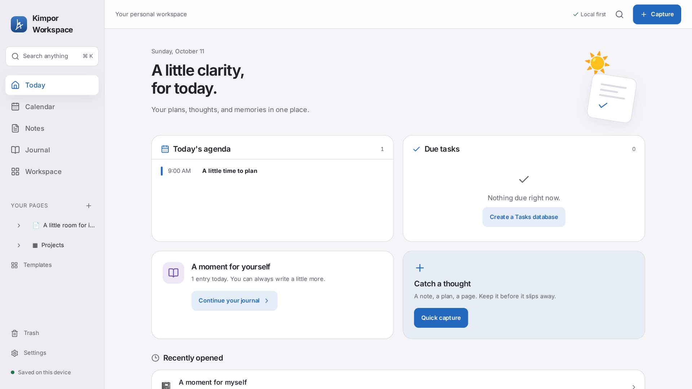
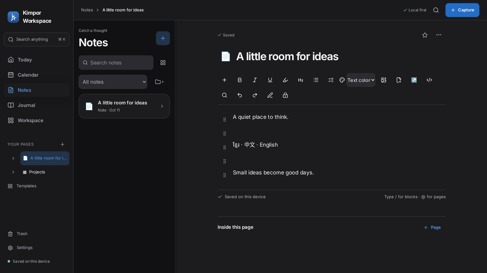
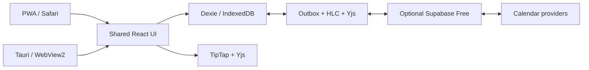

# Kimpor Workspace

A local-first workspace for days and ideas. Today, Calendar, Notes, Journal and
Workspace share one editor and one data model. The app runs as a PWA; the Windows
Tauri package and release workflows are included.

**Live preview:** [Open Kimpor Workspace](https://kangkimpor.github.io/kimpor-workspace/).
Source is published on main. The dedicated free cloud backend is deployed and
passes real Auth, sync, ownership and private-file checks. The public app passes
offline editing/reload and cloud-account-screen checks in Chromium and WebKit.
Windows installers build and installed UI/restart checks pass; memory, typing
and physical-device gates remain open. Version is 0.0.1, with no production release.
See [the implementation report](docs/PHASES-1-3-REPORT.md) and
[feature-by-feature verification](docs/VERIFICATION.md) for supported behavior and gaps.




## Run

Use Node 24 and pnpm 11.19.0:

```sh
pnpm install --frozen-lockfile
pnpm hooks:install
pnpm dev
```

Open `/` for the workspace, `/design` for the design gallery and `/spikes/editor`
for the original editor study. Cloud configuration is optional. With no environment
values, editing and exports work locally. IndexedDB data belongs to this browser
origin; export before changing hosts or clearing browser data.

## Features

- Nested pages, favorites, move/duplicate/restore, backlinks, tags and templates.
- Rich text, checklists, tables, code highlighting, mentions, files and images,
  columns, LaTeX equations, sketching and document encryption with a recovery key.
- Databases with table, list, board, calendar and gallery views; typed properties,
  filters, sorts, groups, relations and rollups. Each row is a page.
- Local day/week/month/agenda calendars, RRULE recurrence, time zones, quick add,
  drag editing, reminders and ICS import/export.
- Notes folders, journal prompts/mood/compact week/history/memories/focus, local search,
  appearance settings, app lock and full-data ZIP backup/restore.
- Optional Supabase auth/sync, encrypted attachment transport and server-side
  Google, Outlook, CalDAV/iCloud and read-only ICS adapters. The backend is live;
  calendar providers require consent and configuration. Supabase’s default free
  email sender accepts project-team addresses only; see [backend setup](supabase/README.md).

Document encryption protects bodies and file keys. Titles, dates, tags and other
record metadata remain visible to the server. App lock hides the interface; use
document encryption to protect stored content. Keep recovery keys and backups safe.

## Verify

```sh
pnpm check
pnpm run licenses
pnpm licenses:deno
pnpm licenses:cargo
bash scripts/sql-test.sh
bash scripts/deno-install.sh
/tmp/velora-deno/deno check --config supabase/functions/deno.json supabase/functions/*/index.ts
/tmp/velora-deno/deno test --allow-env --config supabase/functions/deno.json supabase/tests/edge_test.ts
pnpm exec playwright install --with-deps chromium webkit firefox
pnpm e2e
```

Docker is required for the isolated PostgreSQL checks. Build and start a preview
on port 4173 before `pnpm shots`, `pnpm performance` or `pnpm lighthouse`. The
[large-workspace benchmark](docs/PERFORMANCE.md) records functional checks and the
remaining typing-budget failure. Screenshot captures cover
13 screens, 12 viewport profiles and both themes. The 0.1% pixel gate requires a
reviewed baseline from the real GitHub runner. All 312 runner captures have been
reviewed and committed with their provenance; CI compares against them.

## Install and deploy

On iPhone/iPad, open the deployed app in Safari → Share → Add to Home Screen.
Desktop browsers use their install menu. The first visit must be online; cached
operation depends on the browser retaining storage. Foreground sync resumes on
focus or reconnect. iOS does not guarantee background execution.

`pnpm build:desktop` creates embedded assets without a service worker. On Windows
with Rust and Visual Studio C++ Build Tools, run
`pnpm --filter @veloradesk/desktop build`. Initial NSIS installers are unsigned for
Authenticode. Tauri updater signatures are a separate mechanism. The real Windows
runner passes install, window, protocol forwarding, normal exit and uninstall
checks, including multilingual note creation and app restart. The latest completed
installed-UI run uses 390.4 MiB across the app and WebView2, exceeding the unchanged
150 MiB gate. Installer candidates remain available for testing. N→N+1 updater and physical
device verification are pending.

[Setup](docs/SETUP-CHECKLIST.md) covers the free service configuration and secrets.
Source is published directly to [main](https://github.com/KangKimpor/kimpor-workspace).
GitHub Actions and free GitHub Pages are configured; actual run and deployment
outcomes are recorded in the verification report.

## Architecture



See [free-tier limits](docs/FREE-TIER.md), [platform differences](docs/PLATFORM-DIFFERENCES.md),
[manual device checks](docs/DEVICE-TEST.md), [working memory](CLAUDE.md) and the
[project skill draft](SKILL.md). Public branding uses the signature-derived A
monogram; the original signature is private and excluded from Git.

MIT licensed. See [third-party notices](THIRD-PARTY-NOTICES.md).
