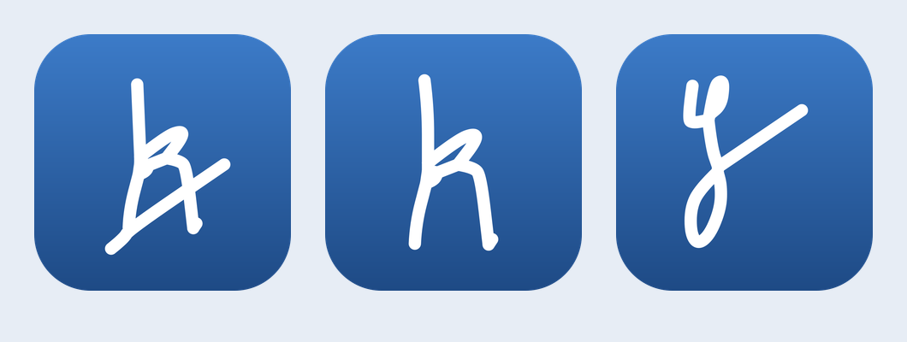

# VeloraDesk Phase 0 report

2026-10-10. **Local foundation implemented and verified; Phase 0 exit remains
pending repository/CI/deployment and physical-device gates.** Phase 1 has not begun.
This takeover continues the original project and accepted free-service workarounds.

## What works locally

- Shared React/TypeScript monorepo, original light/dark tokens, responsive gallery,
  Pressable feedback, reduced motion, accessible sheets, saved appearance and Cmd/Ctrl+K.
- Real TipTap/Yjs multilingual editor study, persistent transactional IndexedDB,
  same-origin tab updates, slash formatting and separate keyboard-sortable rows.
- PWA shell/assets and cached offline reload/edit/reconnect. Desktop frontend
  excludes the service worker. Windows Tauri/Rust/NSIS, native frame, single-instance
  callback and scoped platform adapters are scaffolded, not yet compiled.
- A password-protected updater key pair exists locally; public key is configured.
  Private key/password are ignored and have not been uploaded as repository secrets.
- Conventional Commit preparation, CI/CodeQL/Dependabot, per-user Windows smoke,
  visual candidate/diff gate and portable Pages/Vercel hosting configurations.

## Verification and evidence

`pnpm check`, JS/native license audits and the desktop frontend build pass locally.
Actionlint v1.7.12 reports no workflow errors. Gitleaks scans staged source before
each commit with a checksum-verified binary; no leaks were found.
Ten core tests cover HLC, generated LWW invariants, quota/callback/CORS and three
disconnected Yjs documents. Four scoped contracts have 100% line/function/statement
coverage and 97.56% branch coverage; this is not full application coverage.

**32 browser checks pass** across Chromium, WebKit, Firefox and phone WebKit.
Axe scans return zero violations for the tested gallery/editor/about screens in
both themes. Tests cover focus return, theme persistence, under-100ms press
feedback, multilingual persistence/composition guards, two local tabs, offline
reload, keyboard row reorder, 200% text and the dark WebKit regression.

**96 screenshots** cover four screens × twelve matrix entries × two themes.
All eight contact sheets were inspected. Narrow layouts have no detected horizontal
overflow; the black inherited WebKit headings found during review were fixed and
recaptured. No remaining alignment defect was identified in these captures.
This is human screenshot review and layout assertions, not approved CI pixel baselines.

Initial JS is **126.9 KiB gzip**, additional lazy editor JS **199.4 KiB**, each
below 250 KiB. Workbox's 24 precached entries total about 1.19 MiB uncompressed;
background precaching is separate from the initial execution graph. Forty-four
semantic color pairs meet contrast thresholds. One local desktop Lighthouse run
scores **100 performance / 100 accessibility / 100 best practices / 91 SEO**,
LCP 422ms, TBT 33.5ms, CLS 0.000294. It passes configured budgets and is not a
physical-device performance result.

[Verification ledger](VERIFICATION.md), [capture matrix](evidence/screenshot-matrix.json),
[contrast](evidence/contrast.json), [Lighthouse](evidence/lighthouse-summary.json),
[JS licenses](evidence/dependency-licenses.json), [291 Windows crate licenses](evidence/cargo-windows-licenses.json).
The local Pages build with its CSP meta also passes direct gallery/editor
navigation and cached offline reload under `/veloradesk/` in Chromium and WebKit
([subpath evidence](evidence/pages-subpath.json)).
Tauri JSON configuration validates; Cargo.lock is generated. Native Windows
compilation, installer size and execution are unverified.

## Signature and selected logo

The actual supplied JPEG is stored privately. Its measured median ink #265B9A
replaces the old prompt's reference seed; tested accent colors remain unchanged.
The three public directions are traced from isolated signature strokes, not a font.

| Direction | 16px | 32px | Distinctness | One color | Fidelity |
| --- | ---: | ---: | ---: | ---: | ---: |
| A: opening K + tail sweep | 3 | 5 | 5 | 5 | 5 |
| B: opening K | 4 | 5 | 5 | 5 | 5 |
| C: terminal loop + tail | 4 | 4 | 4 | 5 | 5 |

Scores are visual judgments, 1–5. **A is selected by the requested default**;
its characteristic sweep survives at 32px. Concepts were shown before replacing
placeholder artwork. [Full size/background contact sheet](../brand/exports/monogram-review.png)
and [construction/export notes](../brand/README.md). SVG masters, adaptive/bold
favicons, PWA/Apple/Windows icons, social images and NSIS bitmaps are generated.
Only the derived monogram ships publicly; full source/outline signature stays ignored.
Physical icon masking, Windows scaling and pinned taskbar checks remain pending.

## Spike decisions

| Spike | Decision and evidence | Remaining gate |
| --- | --- | --- |
| Editor | Go: real TipTap/Yjs binding, multilingual saved text, guarded slash, two tabs, keyboard sample drag and passing budget | Native Khmer/Chinese IME, selection, long-press rich-text block drag, keyboard toolbar |
| Sync | Go for Phase 1: generated scalar invariants, HLC checks and three disconnected Yjs docs converge after duplicate/reordered delivery | Authenticated three-device application sync, owner RLS, outbox/cursors/backoff/deletes |
| Desktop auth | Go for scaffold: exact callback/state/expiry/CORS contracts, deny-by-default native adapter and installer smoke workflow | Real native build and system-browser PKCE/Supabase code exchange |
| Hosting/data | Go: optional current free cloud, portable origins, unified owner-scoped pages/model ADRs | Actual free account plans, deployed origin, migrations and quotas |

Read [ADRs](adr/). These decisions are bounded by the listed gates; they are not
claims that full product editors, cloud sync or provider login exist.

## Publication blocker and missing exit gates

GitHub identifies **KangKimpor**, but repository creation was rejected through both
GraphQL and `POST /user/repos`: **403, “Resource not accessible by integration.”**
The requested repository is still not accessible. A single request to create an
empty public repo and include it in connection access is pending. No tokens or
private sources have been printed or published.

There is **no live repository/PR/CI run, public preview or Windows installer URL**
to report. Local preview is `http://127.0.0.1:4173/design`, only inside this workspace.
The expected Pages address is `https://kangkimpor.github.io/veloradesk/`, **not yet
live**. Vercel remains preferred, but this session has no callable deploy tool or
credential and has not verified the account's Hobby plan. No existing Supabase
project was changed.

Visual comparison deliberately fails until an approved CI baseline exists. After
repository access, the `record-visual-baseline` PR label captures a candidate on
GitHub's runner. Review/commit it, remove the label, rerun Quality and the
`build-desktop` job, then merge/publish only after required checks pass.

Other gaps: physical iPhone/iPad Home Screen install, native Windows install/
uninstall/scaling, native IME/touch selection/drag, VoiceOver/Narrator, live OAuth,
email delivery, cloud migrations/RLS/sync, signed updater delivery and product
performance. Quota contracts are implemented; live meter/upload gates, backups
and keepalive are future engine work. Source license metadata has been audited;
a compiled-binary notices audit is part of release verification.

## User actions

1. [Create the empty public repository](https://github.com/new): KangKimpor,
   `veloradesk`, no README/.gitignore/license initialization. Include it in the
   connection's selected repositories if required, then reply “created”. The
   prepared source can be pushed and its CI/deploy/native gates completed.
2. Back up the ignored updater private key and separate password securely. Keep
   them out of the public source ZIP/repository. Upload the two GitHub secret names
   in [SETUP-CHECKLIST.md](SETUP-CHECKLIST.md) once the repository exists.
3. Once actual preview/installer URLs exist, run the relevant Phase 0 entries in
   [DEVICE-TEST.md](DEVICE-TEST.md) on iPhone/iPad/Windows and record date/OS/results.
4. After Phase 0 gates/report, say “continue” to authorize Phase 1. It is large:
   P1 modules, full editor, authenticated local-first sync and real auth. Phase 2
   and Phase 3 are also large; no completion dates or perpetual vendor guarantees.

The current source, construction masters and evidence are saved. No paid service,
trial, external messaging or unrelated cloud modification was performed.
